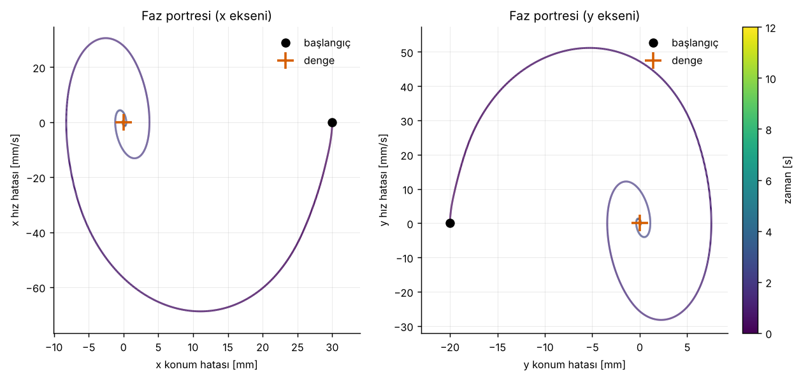
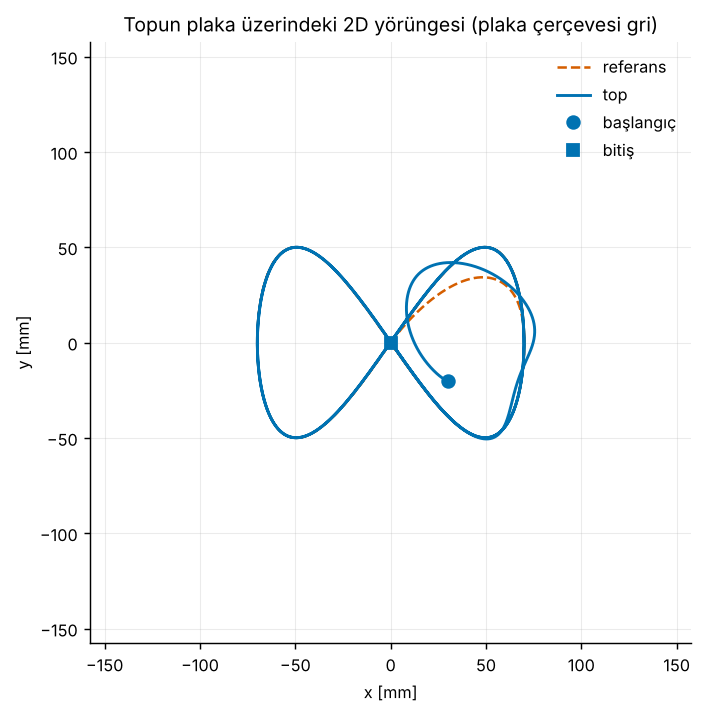
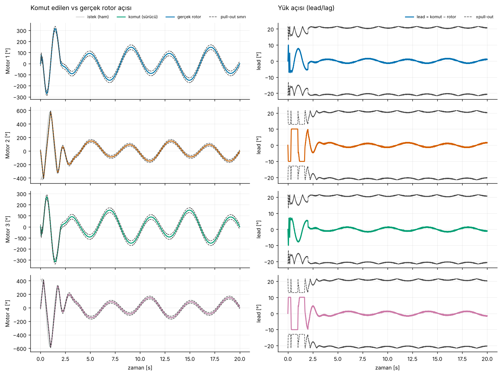
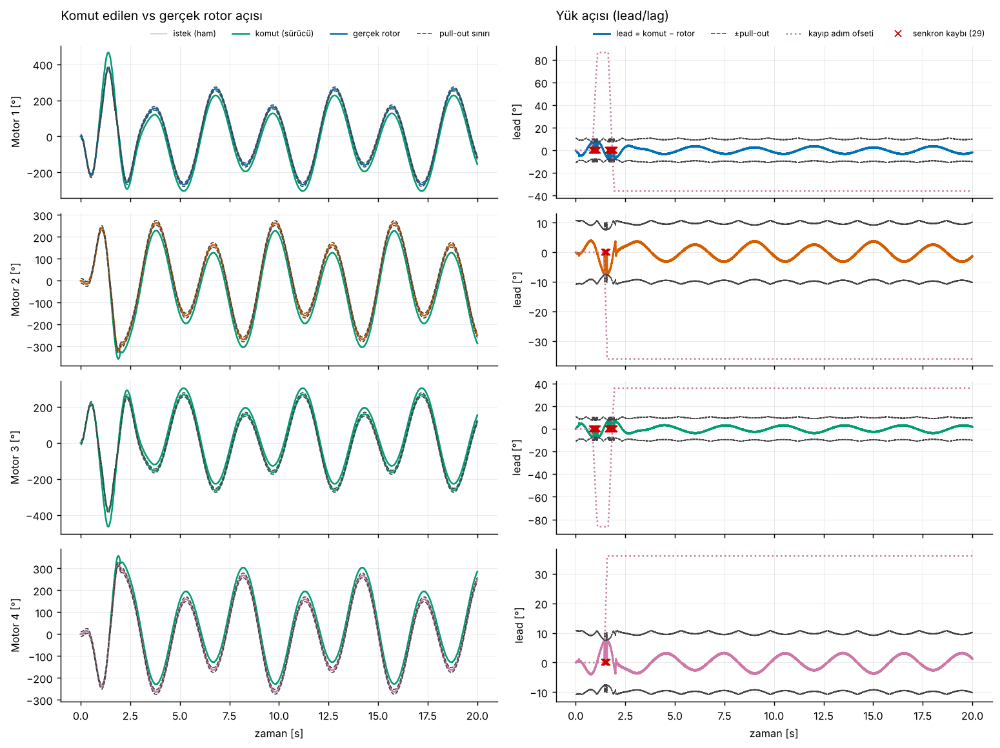
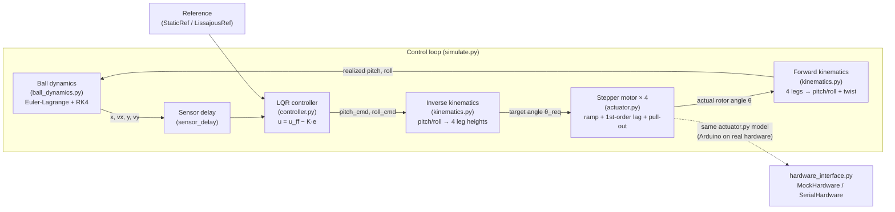

# Ball-on-Plate Balancing Simulation (4-Leg Stepper / Stewart-like Platform)

[Türkçe sürüm](README.md)


## Project Summary

An end-to-end control simulation that balances a ball rolling on a plate
carried by four stepper-motor legs, using only camera-style position/velocity
feedback. The full chain is modeled, not simplified: ball dynamics
(Euler-Lagrange, derived symbolically with sympy) → outer-loop LQR controller
→ inverse kinematics → a realistic stepper-motor model (ramp, first-order
lag, **pull-out / lost-step**) → forward kinematics → plate tilt → ball. The
goal is to make the limitations a real hardware build will face (motor
pull-out, sensor delay, stroke limits) visible in simulation, instead of
assuming an ideal actuator.

## Visuals

**Balance test — phase portrait (x/y error-velocity plane, fixed setpoint):**



**Lissajous (figure-eight) tracking — 2D ball path:**



**Lissajous tracking — 4 stepper motors (commanded/actual angle, lead, pull-out limit):**



**Stress test (weak motor + fast trajectory) — visible lost-step events:**



**3D animation:** `output/lissajous_d_animasyon.mp4` ([watch directly](output/lissajous_d_animasyon.mp4))

> TODO: this MP4 cannot be auto-played inline in a GitHub README (GitHub
> doesn't render `<video>` tags). For an embedded, auto-playing preview,
> convert a ~10-15s clip of `lissajous_d_animasyon.mp4` to a GIF, e.g.
> `ffmpeg -i lissajous_d_animasyon.mp4 -vf "fps=15,scale=480:-1"
> output/lissajous_d_animasyon.gif`.

## Architecture / Data Flow



Plate angular velocity is neglected; the ball state is assumed to be exactly
known as a measurement, but delayed by `sensor_delay` (camera + estimator
lag). `hardware_interface.py` provides an abstract interface so the same
controller/kinematics layers can later drive real hardware (Arduino + step
driver + camera): an empty skeleton (`SerialHardware`) and a mock backend
(`MockHardware`) driven by `actuator.StepperMotor`.

## Model / Algorithm Summary

- **Ball dynamics:** a homogeneous sphere rolling without slipping on the
  plate. The Lagrangian `L = ½(m + I/r_b²)(ẋ²+ẏ²) − m g z(x,y)` is built and
  solved symbolically with sympy (Euler-Lagrange), linearized about the
  equilibrium (A, B matrices), and the nonlinear state is also integrated
  with RK4. For small angles, acceleration ≈ `(g/(1+β))·angle` (solid sphere,
  β=2/5 → 5g/7).
- **Outer-loop controller:** an LQR gain `K` computed with `python-control`'s
  `lqr`, using weights close to Bryson's rule, plus a feedforward tilt
  (`u_ff`) that supplies the reference acceleration; the output is clipped to
  the stroke/tilt limit.
- **Inverse/forward kinematics:** leg heights from the exact (no small-angle
  assumption) inverse kinematics given the 4 legs' world-frame positions;
  since the 4 legs may not stay coplanar under actuator error, forward
  kinematics fits a least-squares plane and reports the residual ("twist").
- **Stepper motor model:** two layers — (1) an open-loop driver: rounding to
  microsteps plus a step-rate/acceleration limit (trapezoidal ramp), (2) a
  rotor that tracks the command with a first-order lag; if the load angle
  (`lead`) exceeds the motor's speed-dependent pull-out limit, a lost-step
  (loss of synchronism) event is simulated.

## Code Structure

| File | Contents |
|---|---|
| `ball_dynamics.py` | Symbolic Euler-Lagrange derivation (sympy), linearization (A, B), RK4 integrator |
| `controller.py` | python-control LQR + feedforward, reference generators (`StaticRef`, `LissajousRef`) |
| `kinematics.py` | `PlateGeometry`: inverse/forward kinematics, leg height ↔ lead-screw angle |
| `actuator.py` | `StepperMotor`: ramp + f_max, first-order lag, pull-out / lost-step |
| `simulate.py` | Full closed loop + CLI (`balance` / `lissajous`, `--stress`, `--no-anim`, ...) |
| `visualize.py` | 4 outputs: trajectory, phase portrait, motor plots, 3D animation |
| `hardware_interface.py` | Abstract interface for real hardware (Arduino/camera) + `MockHardware` skeleton |
| `test_sanity.py` | pytest/standalone sanity tests |

## Setup and Run

```bash
pip install -r requirements.txt

python simulate.py balance               # 1) fixed-setpoint balance test
python simulate.py lissajous             # 2) figure-eight (Lissajous) tracking (+ 3D animation)
python simulate.py lissajous --stress    # weak motor: pull-out / lost-step
python simulate.py lissajous --no-anim   # no animation (animation takes ~2 min)
python test_sanity.py                    # quick sanity check (or: python -m pytest -q)
```

Outputs are written under `output/`: `a_yorunge`/trajectory,
`b_faz_portresi`/phase portrait, `c_motorlar`/motors (PNG), `d_animasyon`
(GIF, plus MP4 if `ffmpeg` is installed).

> Note: saving the 3D animation as a GIF requires `Pillow` (matplotlib's
> `PillowWriter`); the MP4 export additionally requires `ffmpeg` on the
> system.

## Sanity Tests (`test_sanity.py`)

| Test | What it checks |
|---|---|
| `test_dynamics_matches_literature` | Small-angle ball acceleration = (5/7)·g·sin(θ) (solid sphere, literature value), 1e-9 tolerance |
| `test_kinematics_roundtrip` | forward(inverse(pitch, roll)) ≡ (pitch, roll), twist ≈ 0 (1e-12 tolerance) |
| `test_lqr_stable` | All eigenvalues of the closed-loop matrix `A − B·K` have negative real parts (stable) |
| `test_stepper_loses_sync_when_overdriven` | An overdriven motor (low pull-out limit) actually produces a lost-step event |
| `test_balance_converges` | At a fixed reference the ball converges to the center (<1 mm) without falling off or losing sync |

Numeric results (RMS/max position error, max tilt, max load angle) are
printed to the console on every run by `simulate.py`'s `summarize()`
function; since they depend on the motor/sensor parameters chosen, this
README reports the test suite rather than a fixed numbers table — run the
code to reproduce them.

## Assumptions and Limitations

- Centrifugal/Coriolis terms from the plate's angular velocity are neglected
  (a standard simplification in the literature).
- The ball state is assumed to be exactly known as a measurement, only
  delayed by `sensor_delay` (a real camera + estimator would also add
  noise/dropouts).
- Motor parameters (`tau`, pull-out angle, ramp) are placeholders; moving to
  a real stepper requires re-fitting them from the motor's torque-speed
  curve or a measured step response.

## References

| Library | Purpose | License | Link |
|---|---|---|---|
| NumPy | Numerical arrays, linear algebra | BSD-3-Clause | https://numpy.org/ |
| SymPy | Symbolic Euler-Lagrange derivation, lambdify | BSD-3-Clause | https://www.sympy.org/ |
| python-control | LQR gain computation (`control.lqr`) | BSD-3-Clause | https://python-control.org/ |
| Matplotlib | 2D plots, 3D animation (mplot3d) | Matplotlib License (PSF-based, permissive) | https://matplotlib.org/ |

All dependencies use permissive licenses; there is no copyleft dependency.
The repository is therefore released under the **MIT** license (`LICENSE`).

## Attribution

This project is part of the "Simulation Systems" portfolio series and was
inspired by content shared on Instagram by
[@veer.alak.sim](https://www.instagram.com/veer.alak.sim/).
