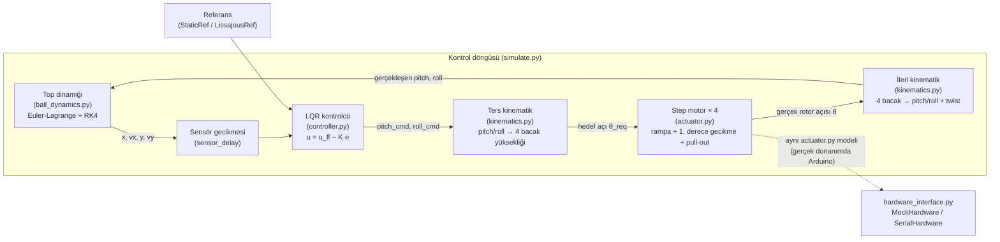

# Top-Plaka Dengeleme Simülasyonu (Ball-on-Plate / Stewart-benzeri)

[English version](README.en.md)


## Proje Özeti

Dört step-motor bacaklı bir plaka üzerinde yuvarlanan bir topu, sadece kamera
görüntüsünden (konum/hız) gelen ölçümle dengede tutan, uçtan uca bir kontrol
simülasyonu. Zincir tek parça halinde modellenir: top dinamiği (Euler-Lagrange,
sympy ile türetilir) → LQR dış döngü kontrolcüsü → ters kinematik → gerçekçi
step motor modeli (rampa, birinci derece gecikme, **pull-out/senkron kaybı**) →
ileri kinematik → plaka eğimi → top. Hedef, "ideal aktüatör" basitleştirmesi
yapmadan, gerçek donanıma geçildiğinde karşılaşılacak sınırları (motor
pull-out'u, sensör gecikmesi, strok sınırı) simülasyonda görünür kılmak.

## Görseller

**Denge testi — faz portresi (x/y hata-hız düzlemi, sabit referans):**


**Lissajous (sekiz) yörüngesi takibi — 2D top yolu:**


**Lissajous takibi — 4 step motor (komut/gerçek açı, lead, pull-out sınırı):**


**Stres testi (zayıf motor + hızlı yörünge) — senkron kaybı (kayıp adım) görünür:**


**3D animasyon:** `output/lissajous_d_animasyon.mp4` ([doğrudan izle](output/lissajous_d_animasyon.mp4))

> TODO: Bu MP4, GitHub README içinde doğrudan oynatılamıyor (GitHub README'leri
> `<video>` etiketini render etmiyor). README'de gömülü, otomatik oynayan bir
> önizleme için `lissajous_d_animasyon.mp4` dosyasının ~10-15 saniyelik bir
> bölümünün GIF'e çevrilmesi önerilir (ör. `ffmpeg -i lissajous_d_animasyon.mp4
> -vf "fps=15,scale=480:-1" output/lissajous_d_animasyon.gif`).

## Mimari / Veri Akışı



Simülasyonda plaka açısal hızı ihmal edilir; top durumu ölçüm olarak tam
bilinir ama `sensor_delay` kadar geriden (kamera + tahminci gecikmesi).
`hardware_interface.py`, aynı kontrolcü/kinematik katmanlarının gerçek bir
Arduino + step sürücü + kameraya bağlanması için boş bir iskelet
(`SerialHardware`) ve `actuator.StepperMotor` ile çalışan bir sahte donanım
(`MockHardware`) sağlar.

## Kullanılan Model / Algoritma Özeti

- **Top dinamiği:** Plaka üzerinde kaymadan yuvarlanan homojen küre.
  Lagrangian `L = ½(m + I/r_b²)(ẋ²+ẏ²) − m g z(x,y)` sympy ile kurulup
  Euler-Lagrange denklemleri sembolik olarak çözülür, denge noktası etrafında
  doğrusallaştırılır (A, B matrisleri) ve ayrıca doğrusal olmayan hal RK4 ile
  integre edilir. Küçük açıda ivme ≈ `(g/(1+β))·açı` (dolu küre, β=2/5 → 5g/7).
- **Dış döngü kontrolcü:** `python-control`'ün `lqr` fonksiyonu ile Bryson
  kuralına yakın ağırlıklarla LQR kazancı `K`; buna referans ivmesini
  sağlayan bir ileri besleme eğimi (`u_ff`) eklenir, çıktı strok/eğim
  sınırına kırpılır.
- **Ters/ileri kinematik:** 4 bacağın dünya koordinatlarındaki konumundan,
  tam (küçük açı varsayımı olmadan) ters kinematik ile bacak yükseklikleri;
  ileri kinematikte 4 bacak düzlemsel olmayabileceği için en küçük kareler
  düzlemi uydurulup kalıntı ("twist") raporlanır.
- **Step motor modeli:** İki katman — (1) açık çevrim sürücü: mikroadıma
  yuvarlama + adım frekansı/ivme sınırı (trapez rampa), (2) rotor: birinci
  derece gecikmeyle komutu izler, yük açısı (`lead`) motorun hız-bağımlı
  pull-out sınırını aşarsa senkron kaybı (kayıp adım) simüle edilir.

## Kod Yapısı

| Dosya | İçerik |
|---|---|
| `ball_dynamics.py` | sympy ile Euler-Lagrange türetimi, doğrusallaştırma (A, B), RK4 integratör |
| `controller.py` | python-control LQR + ileri besleme, referans üreticiler (`StaticRef`, `LissajousRef`) |
| `kinematics.py` | `PlateGeometry`: ters/ileri kinematik, bacak ↔ vidalı mil açısı dönüşümü |
| `actuator.py` | `StepperMotor`: rampa + f_max, 1. derece gecikme, pull-out/kayıp adım |
| `simulate.py` | Tam kapalı döngü + CLI (`balance` / `lissajous`, `--stress`, `--no-anim`, ...) |
| `visualize.py` | 4 çıktı: yörünge, faz portresi, motor grafikleri, 3D animasyon |
| `hardware_interface.py` | Gerçek donanığa (Arduino/kamera) geçiş için soyut arayüz + `MockHardware` iskeleti |
| `test_sanity.py` | pytest/standalone doğrulama testleri |

## Kurulum ve Çalıştırma

```bash
pip install -r requirements.txt

python simulate.py balance               # 1) sabit denge testi
python simulate.py lissajous             # 2) sekiz (Lissajous) takibi (+ 3D animasyon)
python simulate.py lissajous --stress    # zayıf motor: pull-out / kayıp adım
python simulate.py lissajous --no-anim   # animasyonsuz (animasyon ~2 dk sürer)
python test_sanity.py                    # hızlı doğrulama (veya: python -m pytest -q)
```

Çıktılar `output/` altına yazılır: `a_yorunge`, `b_faz_portresi`, `c_motorlar`
(PNG), `d_animasyon` (GIF, ve `ffmpeg` kuruluysa ayrıca MP4).

> Not: 3D animasyon GIF kaydı `Pillow` gerektirir (matplotlib'in
> `PillowWriter`'ı); MP4 için ek olarak sistemde `ffmpeg` bulunmalıdır.

## Doğrulama Testleri (`test_sanity.py`)

| Test | Ne doğrular |
|---|---|
| `test_dynamics_matches_literature` | Küçük açıda top ivmesi = (5/7)·g·sin(θ) (dolu küre, literatür değeri) ile 1e-9 toleransla eşleşir |
| `test_kinematics_roundtrip` | İleri(ters(pitch, roll)) ≡ (pitch, roll), twist ≈ 0 (1e-12 toleransla) |
| `test_lqr_stable` | Kapalı çevrim matrisi `A − B·K`'nin tüm özdeğerleri negatif reel kısımlı (kararlı) |
| `test_stepper_loses_sync_when_overdriven` | Aşırı zorlanan (düşük pull-out limitli) bir motor gerçekten senkron kaybı üretir |
| `test_balance_converges` | Sabit referansta top, düşmeden ve senkron kaybı olmadan merkeze (<1 mm) yakınsar |

Sayısal sonuçlar (RMS/maks konum hatası, maks eğim, maks yük açısı) her
çalıştırmada `simulate.py` tarafından konsola yazdırılır (`summarize()`
fonksiyonu); bunlar motor/sensör parametrelerine bağlı olduğu için burada
sabit bir tablo yerine kod çalıştırılarak üretilmesi önerilir.

## Varsayımlar ve Sınırlamalar

- Plaka açısal hızından gelen merkezkaç/Coriolis terimleri ihmal edilir
  (literatürdeki standart basitleştirme).
- Top durumu ölçüm olarak tam bilinir, sadece `sensor_delay` kadar gecikmelidir
  (gerçek bir kamera + tahminci gürültü/kesinti de ekler).
- Motor parametreleri (`tau`, pull-out açısı, rampa) yer tutucu değerlerdir;
  gerçek bir step motora geçerken motorun tork-hız eğrisinden veya adım
  yanıtı ölçümünden yeniden uydurulmalıdır.

## Kaynakça / References

| Kütüphane | Amaç | Lisans | Link |
|---|---|---|---|
| NumPy | Sayısal dizi işlemleri, lineer cebir | BSD-3-Clause | https://numpy.org/ |
| SymPy | Sembolik Euler-Lagrange türetimi, lambdify | BSD-3-Clause | https://www.sympy.org/ |
| python-control | LQR kazanç hesabı (`control.lqr`) | BSD-3-Clause | https://python-control.org/ |
| Matplotlib | 2D grafikler, 3D animasyon (mplot3d) | Matplotlib Lisansı (PSF tabanlı, izin verici) | https://matplotlib.org/ |

Tüm bağımlılıklar izin verici (permissive) lisanslıdır; bulaşıcı (copyleft)
bir bağımlılık yoktur. Bu nedenle depo **MIT** lisansı ile yayınlanmıştır
(`LICENSE`).

## Attribution

Bu proje, "Simulation Systems" portföy serisinin bir parçasıdır ve
Instagram'da [@veer.alak.sim](https://www.instagram.com/veer.alak.sim/)
hesabında paylaşılan bir içerikten esinlenilerek geliştirilmiştir.
